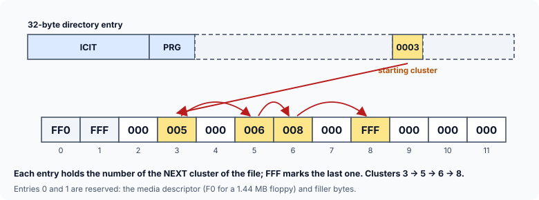
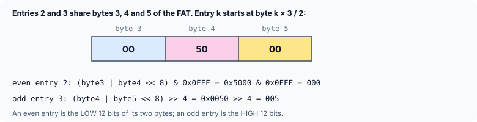

title : Exploring the Disk: The File Allocation Table

summary : See how the FAT file system, still used on USB sticks and memory cards, records where every file is stored: boot sector, FAT, directory and data area, clusters, and FAT chains that work like linked lists. Then decode 12-bit and 16-bit FAT entries correctly with pointers and bitwise operators.

# Exploring the Disk: The File Allocation Table

The previous chapters were about how pointers work. This final chapter puts them to use in larger applications: exploring a disk, building a dictionary, managing a database, converting and evaluating expressions, and more. We begin with the disk.

Floppy disks, hard disks, USB sticks and memory cards differ in size and technology, but a programmer is mostly concerned with how the information on them is **organised**. This article looks at the **FAT** file system — the one used by MS-DOS and early Windows, and still the standard format for USB sticks and SD cards, because almost every device can read it. It is also a beautiful example of a linked list stored on a disk.

## The Four Parts of a FAT Disk

In DOS and Windows, drives are numbered from zero: drive A is number 0, B is 1, C is 2, and so on. A hard disk can be divided into several partitions, each acting as a separate drive. Every FAT drive is divided into four logical parts:

1. **Boot sector** — information about how the disk is organised: bytes per sector, sectors per cluster, the size and number of FATs, and so on. (Its layout was decoded in the structures exercises.)
2. **File Allocation Table (FAT)** — a map of which parts of the data area belong to which file. There are usually **two** copies of it.
3. **Root directory** — one 32-byte entry for each file or subdirectory: its name, attributes, size, date, time, and the number of its **first cluster**.
4. **Data area** — the contents of the files and subdirectories themselves.

On a 1.44 MB floppy, for example, the boot sector is sector 0 of side 0, track 0; the two copies of the FAT occupy the next 18 sectors; and the root directory follows on track 1, with the data area after it.

## Clusters and the FAT

When a file is created, space is not allocated one sector at a time but in groups of sectors called **clusters**. How many sectors form one cluster depends on the size of the disk.

The FAT has **one entry for each cluster** in the data area, and each entry holds one of these values:

| 12-bit | 16-bit | 32-bit | Meaning |
|---|---|---|---|
| `000` | `0000` | `0000000` | cluster available (free) |
| `FF0`–`FF6` | `FFF0`–`FFF6` | `FFFFFF0`–`FFFFFF6` | reserved cluster |
| `FF7` | `FFF7` | `FFFFFF7` | bad cluster (a defect on the disk) |
| `FF8`–`FFF` | `FFF8`–`FFFF` | `FFFFFF8`–`FFFFFFF` | last cluster of a file |
| any other | any other | any other | the number of the **next** cluster of the file |

The last row is the key. The clusters of a file need not be next to each other; each FAT entry says which cluster comes **next**. So the space belonging to a file is described by a **chain** of FAT entries — exactly a linked list, in which the "node" is a cluster and the "link" is the FAT entry for that cluster. The directory entry holds the number of the first cluster, like the pointer to the first node.



To load ICIT.PRG, the operating system reads cluster 3 (from the directory entry), then looks at FAT entry 3 and finds 5, so it reads cluster 5; entry 5 says 6; entry 6 says 8; entry 8 says FFF — the last cluster. The file occupies clusters 3, 5, 6 and 8.

When a file grows, the system finds free (`000`) entries and adds them to the end of the chain. When a file is deleted, the entries of its chain are set back to `000`. (The data itself stays on the disk until it is overwritten — which is why "undelete" tools can sometimes recover deleted files.)

Because the FAT is vital, two identical copies are kept. Both are updated together; if one becomes unreadable, the other can still be used to salvage the files.

### 12, 16 and 32-bit FATs

The bigger the disk, the more clusters it has, and the more bits a FAT entry needs to number them all:

- In a **12-bit FAT** (FAT12), each entry is 12 bits, so at most 2¹² = 4096 clusters can be numbered — 4078 of them usable, since some values are reserved. Used on floppy disks.
- In a **16-bit FAT** (FAT16), at most 65,536 clusters (65,518 usable).
- In a **32-bit FAT** (FAT32), only 28 of the 32 bits are used, giving up to 2²⁸ = 268,435,456 clusters. FAT32 arrived with Windows 95 OSR2.

The first two entries of every FAT are reserved: the first byte holds the **media descriptor** (`F0` for a 1.44 MB floppy, `F8` for a hard disk, `F9` for a 1.2 MB floppy, `FD` for a 360 KB floppy), and the rest of those entries are filled with `FF`. So the first 3 bytes of a 12-bit FAT, the first 4 of a 16-bit FAT and the first 8 of a 32-bit FAT never hold cluster numbers.

## Reading a 12-bit FAT

A 16-bit FAT is easy to read: entry *n* is simply the two bytes at offset 2*n*, low byte first. A 12-bit FAT is trickier, because its entries are not a whole number of bytes: **every three bytes hold two entries**.



Entry *k* begins at byte *k* × 3 / 2 (integer division). Take the two bytes there as a 16-bit little-endian number. For an **even** entry, the value is its low 12 bits (`& 0x0FFF`); for an **odd** entry, its high 12 bits (`>> 4`).

This program builds the first sector of a FAT12 in memory — the chain of ICIT.PRG — and reads it back:

```c runnable
#include <stdio.h>
#include <string.h>

#define END_OF_CHAIN 0xFFF

/* reads 12-bit FAT entry n: entries are packed two to every three bytes */
unsigned get12(const unsigned char *fat, unsigned n)
{
    const unsigned char *p = fat + n * 3 / 2;  /* the first of the two bytes involved */
    unsigned pair = p[0] | (unsigned)p[1] << 8;

    if (n % 2 == 0)
        return pair & 0x0FFF;                  /* even entry: the low 12 bits */
    else
        return pair >> 4;                      /* odd entry: the high 12 bits */
}

/* writes 12-bit FAT entry n without disturbing its neighbour */
void set12(unsigned char *fat, unsigned n, unsigned value)
{
    unsigned char *p = fat + n * 3 / 2;

    if (n % 2 == 0) {
        p[0] = (unsigned char)(value & 0xFF);
        p[1] = (unsigned char)((p[1] & 0xF0) | (value >> 8));
    } else {
        p[0] = (unsigned char)((p[0] & 0x0F) | ((value & 0x0F) << 4));
        p[1] = (unsigned char)(value >> 4);
    }
}

int main(void)
{
    unsigned char fat[512];                    /* the first sector of a 12-bit FAT */

    memset(fat, 0, sizeof fat);
    set12(fat, 0, 0xFF0);                      /* entry 0: media descriptor F0 + FF */
    set12(fat, 1, 0xFFF);                      /* entry 1: reserved */

    /* the file ICIT.PRG occupies clusters 3, 5, 6 and 8 */
    set12(fat, 3, 5);
    set12(fat, 5, 6);
    set12(fat, 6, 8);
    set12(fat, 8, END_OF_CHAIN);

    printf("first bytes of the FAT: ");
    for (int i = 0; i < 12; i++)
        printf("%02X ", fat[i]);
    printf("\n\nentries 2 to 17:\n");
    for (unsigned k = 2; k < 18; k++) {
        printf("%03X ", get12(fat, k));
        if (k % 8 == 1)
            printf("\n");
    }

    printf("\nICIT.PRG starts at cluster 3 (from its directory entry)\nclusters:");
    for (unsigned c = 3; c != END_OF_CHAIN; c = get12(fat, c))   /* follow the chain */
        printf(" %u", c);
    printf("\n");
    return 0;
}
```

```
first bytes of the FAT: F0 FF FF 00 50 00 00 60 00 08 00 00 

entries 2 to 17:
000 005 000 006 008 000 FFF 000 
000 000 000 000 000 000 000 000 

ICIT.PRG starts at cluster 3 (from its directory entry)
clusters: 3 5 6 8
```

- `get12()` computes `fat + n * 3 / 2`, a pointer to the first of the two bytes that hold entry `n`, combines them into a 16-bit value, and keeps the low or high 12 bits.
- `set12()` does the reverse. Each entry shares a byte with its neighbour, so it must change **only its own four bits** of that shared byte: `(p[1] & 0xF0) | (value >> 8)` keeps the high nibble that belongs to the next entry. Writing the whole byte would corrupt the neighbouring entry.
- The `for` loop at the end follows the chain exactly like a linked-list traversal: `c = get12(fat, c)` plays the part of `p = p->link`, and `END_OF_CHAIN` plays the part of `NULL`.

### A trap in the classic version

Older programs read an entry with:

```c
fatentry = (int *)(pfat + i);
value = (k % 2 == 0) ? (*fatentry & 0x0fff) : (*fatentry >> 4);
```

On a 16-bit DOS compiler, an `int` was 2 bytes, so `*fatentry` read exactly the two bytes needed. With today's 4-byte `int`, it reads **four**:

```c runnable
#include <stdio.h>
#include <string.h>

int main(void)
{
    /* the start of the FAT from the previous program */
    unsigned char fat[16] = {0xF0, 0xFF, 0xFF, 0x00, 0x50, 0x00, 0x00, 0x60, 0x00, 0x08, 0x00, 0x00};

    for (unsigned k = 3; k <= 6; k++) {
        unsigned i = k * 3 / 2;
        unsigned int as_int;                   /* what *(int *)(pfat + i) would read */

        memcpy(&as_int, fat + i, sizeof as_int);
        unsigned wrong = (k % 2 == 0) ? (as_int & 0x0FFF) : (as_int >> 4);
        unsigned right = (k % 2 == 0) ? ((fat[i] | (unsigned)fat[i + 1] << 8) & 0x0FFF)
                                      : ((fat[i] | (unsigned)fat[i + 1] << 8) >> 4);
        printf("entry %u: reading %zu bytes gives %X, reading 2 bytes gives %X\n",
               k, sizeof as_int, wrong, right);
    }
    return 0;
}
```

```
entry 3: reading 4 bytes gives 6000005, reading 2 bytes gives 5
entry 4: reading 4 bytes gives 0, reading 2 bytes gives 0
entry 5: reading 4 bytes gives 8006, reading 2 bytes gives 6
entry 6: reading 4 bytes gives 8, reading 2 bytes gives 8
```

For even entries, the mask `& 0x0fff` happens to throw the extra bytes away. For odd entries, `>> 4` keeps them, so entry 3 comes out as 6000005 instead of 5. Reading through an `int *` that points into a byte array is also not allowed by C's aliasing rules, and the address may not be suitably aligned for an `int`. Building the value from individual bytes, as `get12()` does, is correct on every machine.

## Reading a 16-bit FAT

```c runnable
#include <stdio.h>
#include <string.h>

#define END_OF_CHAIN 0xFFFF

/* 16-bit FAT entry n: two bytes, low byte first */
unsigned get16(const unsigned char *fat, unsigned n)
{
    return fat[2 * n] | (unsigned)fat[2 * n + 1] << 8;
}

void set16(unsigned char *fat, unsigned n, unsigned value)
{
    fat[2 * n] = (unsigned char)(value & 0xFF);
    fat[2 * n + 1] = (unsigned char)(value >> 8);
}

int main(void)
{
    unsigned char fat[512];

    memset(fat, 0, sizeof fat);
    set16(fat, 0, 0xFFF8);                     /* F8: hard disk media descriptor */
    set16(fat, 1, 0xFFFF);
    set16(fat, 3, 5);
    set16(fat, 5, 6);
    set16(fat, 6, 8);
    set16(fat, 8, END_OF_CHAIN);

    for (unsigned row = 0; row < 2; row++) {
        printf("%2u  ", row * 8);
        for (unsigned i = 0; i < 8; i++)
            printf("%04X ", get16(fat, row * 8 + i));
        printf("\n");
    }
    return 0;
}
```

```
 0  FFF8 FFFF 0000 0005 0000 0006 0008 0000 
 8  FFFF 0000 0000 0000 0000 0000 0000 0000 
```

Each entry is two bytes, low byte first, so `get16()` combines `fat[2 * n]` and `fat[2 * n + 1]`. The same chain 3 → 5 → 6 → 8 appears, now ending with `FFFF`, and entry 0 starts with the hard-disk media descriptor `F8`.

## Finding the FAT on a Real Disk

The boot sector says where the FATs are: the first copy starts right after the **reserved sectors** (the boot sector itself is one of them), and the second copy starts **sectors-per-FAT** sectors later:

```c
first_fat  = bs.reservedsec;
second_fat = bs.reservedsec + bs.secperfat;
```

The boot sector also names the file system type ("FAT12   " or "FAT16   " — 8 characters padded with spaces, **not** terminated by `'\0'`; copy it with a length limit, not `strcpy()`). Older programs read these sectors with the DOS function `absread()`, which no longer exists. To explore a real FAT image today, open the image file (for example one made with `dd` from a USB stick) with `fopen()`, `fseek()` to sector × bytes-per-sector, and `fread()` the bytes — then decode them exactly as above. As shown in the structures exercises, decode the boot sector field by field from known offsets rather than reading it into a structure, because of padding.

## Key Takeaways

- A FAT drive has a boot sector, two copies of the FAT, a root directory and a data area. Space is allocated in clusters.
- The FAT has one entry per cluster. An entry holds the next cluster of the same file, or a special value: free, reserved, bad, or end of file.
- A file's clusters form a chain — a linked list on disk — starting at the cluster number in its directory entry.
- FAT12 packs two 12-bit entries into three bytes: entry *k* starts at byte *k* × 3 / 2; even entries are the low 12 bits, odd entries the high 12 bits. FAT16 entries are 2 bytes, FAT32 entries 4 bytes (28 bits used), all little-endian.
- Build multi-byte values from individual bytes; do not read them through an `int *` into a byte buffer.

## Practice Questions

:::details[A FAT12 holds 007 in entry 4, 009 in entry 7, FFF in entry 9, and a file's directory entry says it starts at cluster 4. Which clusters does the file occupy?]
4 → 7 → 9 → end. Clusters **4, 7 and 9**.
:::

:::details[At which byte does FAT12 entry 11 begin, and is it the low or the high 12 bits of its two bytes?]
11 × 3 / 2 = 16 (integer division), so bytes 16 and 17. 11 is odd, so it is the **high** 12 bits: `(fat[16] | fat[17] << 8) >> 4`.
:::

:::details[Why does a disk keep two copies of the FAT?]
Without the FAT there is no way to know which clusters belong to which file, so losing it would lose every file. If one copy becomes unreadable, the other can be used.
:::

:::details[What happens to a file's FAT entries when the file is deleted, and why can the file sometimes be recovered?]
Its chain of entries is set back to `000` (free). The data in the clusters is not erased; it stays until other files reuse those clusters. A recovery tool can sometimes rebuild the chain from the starting cluster still recorded in the deleted directory entry.
:::
