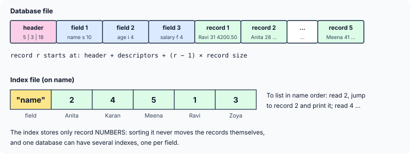

title : Managing a Database: Records, Fields and an Index File

summary : Build a small generic database: a file that describes its own fields, fixed-size records you can jump to with fseek, and an index file that lists records in sorted order without moving them. Uses a linked list of tagged unions to sort values of any field type.

# Managing a Database: Records, Fields and an Index File

A **database file** typically contains many **records**, and each record contains several items of information, called **fields**: an employee record might have a name, an age and a salary. In C, the fields of one record are naturally gathered into a structure, and records are written to and read from the disk with `fwrite()` and `fread()`. Programs usually have functions such as `addrec()`, `modirec()`, `delrec()` and `listrec()` to add, modify, delete and list records.

The trouble is that such functions are written for **one particular structure**. Database programs (DBMS and RDBMS software) work more generally: you describe the fields of a new database when you create it, and the same program then adds, lists and sorts records of any shape. This article builds a small system of that kind, in about two hundred lines.

## The Design

The program does three jobs:

1. **Create a database file and add records.** The user first describes the structure — up to 10 fields, each with a name, a type (`'s'` string, `'i'` integer, `'f'` float), a size and, for floats, a precision (digits after the decimal point) — and then enters the records.
2. **Index the database** on any one field.
3. **List the records in index order.**

To keep the database generic, the file describes **itself**. It starts with a **header** (the number of records, the number of fields, and the size of one record), followed by one **field descriptor** per field, followed by the records, each exactly the same size:



Because every record has the same size, the program never has to search for one: record *r* starts at a position it can **calculate** — the size of the header and descriptors plus (*r* − 1) times the record size — and `fseek()` jumps straight there.

An **index file** lists the database in a sorted order without changing the database at all. It holds the name of the field it is sorted on, followed by **record numbers** in the sorted order. Several index files can exist for one database — one by name, another by salary — and adding records to the database does not disturb them until they are rebuilt.

## The Program

In the original, interactive version, the user types the field descriptions and the records at a menu. Here, to make it runnable, `main()` describes three fields and adds five records itself, then builds and uses two indexes:

```c runnable
#include <stdio.h>
#include <stdlib.h>
#include <string.h>

#define MAXFIELDS 10

/* describes one field of the record: stored at the start of the database file */
struct field
{
    char name[11];
    char type;                                 /* 'i' int, 'f' float, 's' string */
    int length;                                /* bytes the field takes in a record */
    int dec;                                   /* digits after the point, for 'f' */
};

/* the header: how many records and fields, and how long a record is */
struct header
{
    int recnum;
    int nfields;
    int byte_rec;
};

/* one node of the index list: a field value and the record it came from */
struct inode
{
    int recno;
    union                                      /* holds whichever type the field has */
    {
        int i;
        float f;
        char s[21];
    } val;
    struct inode *link;
};

static struct header h;
static struct field f[MAXFIELDS];

/* ---------- creating the database file ---------- */

void add_field(const char *name, char type, int length, int dec)
{
    struct field *p = &f[h.nfields++];

    snprintf(p->name, sizeof p->name, "%s", name);
    p->type = type;
    p->length = (type == 'i') ? (int)sizeof(int) : (type == 'f') ? (int)sizeof(float) : length;
    p->dec = dec;
    h.byte_rec += p->length;
}

/* writes one record; values arrive as text, as if typed by the user */
void add_record(FILE *db, const char *values[])
{
    for (int i = 0; i < h.nfields; i++) {
        if (f[i].type == 'i') {
            int n = atoi(values[i]);
            fwrite(&n, sizeof n, 1, db);
        } else if (f[i].type == 'f') {
            float x = (float)atof(values[i]);
            fwrite(&x, sizeof x, 1, db);
        } else {
            char buf[21] = {0};                /* pad short strings with '\0' */
            snprintf(buf, sizeof buf, "%s", values[i]);
            fwrite(buf, (size_t)f[i].length, 1, db);
        }
    }
    h.recnum++;
}

void write_header(FILE *db)
{
    rewind(db);
    fwrite(&h, sizeof h, 1, db);
    fwrite(f, sizeof f[0], (size_t)h.nfields, db);
}

/* ---------- indexing ---------- */

long data_start(void)
{
    return (long)(sizeof h + (size_t)h.nfields * sizeof f[0]);
}

int compare(const struct inode *a, const struct inode *b, char type)
{
    if (type == 'i')
        return (a->val.i > b->val.i) - (a->val.i < b->val.i);
    if (type == 'f')
        return (a->val.f > b->val.f) - (a->val.f < b->val.f);
    return strcmp(a->val.s, b->val.s);
}

/* builds a sorted linked list of (value, record number) and writes the
   record numbers, in that order, to the index file */
int create_index(FILE *db, FILE *idx, const char *fieldname)
{
    int which = -1, offset = 0;

    for (int i = 0; i < h.nfields; i++) {      /* find the field and its offset */
        if (strcmp(f[i].name, fieldname) == 0) {
            which = i;
            break;
        }
        offset += f[i].length;
    }
    if (which < 0)
        return 0;

    char type = f[which].type;
    struct inode *list = NULL;

    for (int r = 0; r < h.recnum; r++) {
        struct inode *n = calloc(1, sizeof *n);
        if (n == NULL)
            exit(EXIT_FAILURE);
        n->recno = r + 1;

        /* jump straight to this field of record r */
        fseek(db, data_start() + (long)r * h.byte_rec + offset, SEEK_SET);
        if (type == 'i')
            fread(&n->val.i, sizeof n->val.i, 1, db);
        else if (type == 'f')
            fread(&n->val.f, sizeof n->val.f, 1, db);
        else
            fread(n->val.s, (size_t)f[which].length, 1, db);

        /* insert in sorted position (equal values keep their original order) */
        struct inode **q = &list;
        while (*q != NULL && compare(*q, n, type) <= 0)
            q = &(*q)->link;
        n->link = *q;
        *q = n;
    }

    /* the index file: field name, then the record numbers in sorted order */
    fwrite(f[which].name, sizeof f[which].name, 1, idx);
    while (list != NULL) {
        struct inode *next = list->link;
        fwrite(&list->recno, sizeof list->recno, 1, idx);
        free(list);
        list = next;
    }
    return 1;
}

/* ---------- listing in index order ---------- */

void list_indexed(FILE *db, FILE *idx)
{
    char fieldname[11];
    int recno;

    rewind(idx);
    if (fread(fieldname, sizeof fieldname, 1, idx) != 1)
        return;
    printf("Records in order of %s:\n", fieldname);

    while (fread(&recno, sizeof recno, 1, idx) == 1) {
        fseek(db, data_start() + (long)(recno - 1) * h.byte_rec, SEEK_SET);
        printf("  #%d", recno);
        for (int i = 0; i < h.nfields; i++) {
            if (f[i].type == 'i') {
                int n;
                if (fread(&n, sizeof n, 1, db) == 1)
                    printf("  %4d", n);
            } else if (f[i].type == 'f') {
                float x;
                if (fread(&x, sizeof x, 1, db) == 1)
                    printf("  %9.*f", f[i].dec, x);
            } else {
                char s[21] = {0};
                if (fread(s, (size_t)f[i].length, 1, db) == 1)
                    printf("  %-*s", f[i].length, s);
            }
        }
        printf("\n");
    }
}

int main(void)
{
    FILE *db = tmpfile(), *idx = tmpfile();    /* stand-ins for STAFF.DBF and NAME.IDX */
    if (db == NULL || idx == NULL)
        return 1;

    add_field("name", 's', 10, 0);             /* 1. define the structure */
    add_field("age", 'i', 0, 0);
    add_field("salary", 'f', 0, 2);
    write_header(db);                          /* reserve room for the header */

    const char *rows[][3] = {                  /* 2. add the records */
        {"Ravi", "31", "4200.50"}, {"Anita", "28", "5100.00"}, {"Zoya", "35", "3900.75"},
        {"Karan", "24", "4700.25"}, {"Meena", "41", "6050.00"}
    };
    for (int i = 0; i < 5; i++)
        add_record(db, rows[i]);
    write_header(db);                          /* now with the final record count */

    printf("%d records of %d bytes, %d fields\n\n", h.recnum, h.byte_rec, h.nfields);

    const char *keys[] = {"name", "salary"};
    for (int k = 0; k < 2; k++) {              /* 3. index, then 4. list */
        rewind(idx);
        create_index(db, idx, keys[k]);
        list_indexed(db, idx);
        printf("\n");
    }

    fclose(db);
    fclose(idx);
    return 0;
}
```

```
5 records of 18 bytes, 3 fields

Records in order of name:
  #2  Anita         28    5100.00
  #4  Karan         24    4700.25
  #5  Meena         41    6050.00
  #1  Ravi          31    4200.50
  #3  Zoya          35    3900.75

Records in order of salary:
  #3  Zoya          35    3900.75
  #1  Ravi          31    4200.50
  #4  Karan         24    4700.25
  #2  Anita         28    5100.00
  #5  Meena         41    6050.00

```

## How It Works

### Describing the structure: add_field()

Each call to `add_field()` fills in the next `struct field` and adds the field's size to `h.byte_rec`, the size of one record. An integer takes `sizeof(int)` bytes and a float `sizeof(float)`; a string takes the size given. So the record here is 10 + 4 + 4 = 18 bytes.

(Older versions hard-code 2 bytes for an integer and 4 for a float — correct for 16-bit DOS compilers, wrong today. Using `sizeof` gets it right on any compiler.)

### Writing records: add_record()

`add_record()` receives the values as text, as the user would type them, and converts each according to its field's type: `atoi()` for integers, `atof()` for floats. It writes each field with `fwrite()`, so a record is just its fields' bytes, one after another, with no padding.

A string field is always written at its full length. A shorter name is copied into a buffer of zeros first (`char buf[21] = {0}`), so the unused bytes are `'\0'`, and every record really is the same size. (Older versions write `str` with a size that depends on how long the typed text was, and read strings with `gets()`, which cannot stop the user typing past the end of the array.)

### The header: written twice

The header must say how many records the file holds, but that is not known until all the records have been added. So `write_header()` is called **twice**: once before the records, to reserve the space, and once at the end, after `rewind()`, to overwrite it with the final count. The field descriptors are written straight after the header with a single `fwrite()` of the array `f`.

### Building the index: create_index()

`create_index()` first finds the requested field among the descriptors, adding up the sizes of the fields before it. That sum, `offset`, is where the field lies **inside** each record.

Then, for each record, it jumps straight to that field:

```c
fseek(db, data_start() + (long)r * h.byte_rec + offset, SEEK_SET);
```

and reads its value into a new node of a linked list. Each node holds the value and the number of the record it came from.

The node has to hold a value of **any** of the three types. That is a job for a **union**:

```c
struct inode
{
    int recno;
    union
    {
        int i;
        float f;
        char s[21];
    } val;
    struct inode *link;
};
```

All the members of a union share the same memory, so a union is only as big as its largest member. A node uses `val.i`, `val.f` or `val.s`, depending on the field's type — and the program always knows which, because it knows the field's type. A union whose type is recorded elsewhere like this is called a **tagged union**.

(Older versions declare a union of three different structures — one for integers, one for floats, one for strings — each with its own `link` member, and then need casts such as `(union fieldlist *)p->x.link` at every step. Putting the link outside the union, as here, removes all those casts.)

Each new node is inserted at its **sorted** position with the pointer-to-a-link technique from the linked-list articles, using `compare()`, which compares two nodes according to the field's type. Because the test is `<= 0`, records with equal values keep their original order.

(Older versions first build the list unsorted, then sort it with a bubble sort that relinks the nodes, as in the article on sorting linked lists. Inserting in order as the list is built gives the same result with less code.)

Finally, the field's name and then the record numbers, in list order, are written to the index file, and each node is freed as it is written.

### Listing in index order: list_indexed()

`list_indexed()` reads the index file from the beginning: first the field name, then one record number at a time. For each record number, it calculates where that record begins, `fseek()`s there, and reads and prints the fields one by one. `%.*f` prints a float with the precision stored in its descriptor: the `*` takes the number of decimal places from an argument (`f[i].dec`) instead of from the format string. `%-*s` likewise takes the field width from an argument.

The records themselves were never moved: sorting by name and by salary only produced two different lists of record numbers.

## Things a Real Database Adds

This program shows the core ideas. A real database system adds much more:

- **Portability of the file.** The program writes the header, descriptors and numbers in the machine's own binary form, so the file may not be readable on a machine with a different `int` size or byte order. Real file formats fix the size and byte order of every value.
- **Faster indexes.** A list of record numbers must be read from the start; real databases use **B-trees**, a balanced tree with many keys per node, so that a single record can be found in a few disk reads.
- **Updates.** Modifying or deleting records, and keeping indexes up to date as records change.
- **Safety.** Checking every `fread()` and `fwrite()` (the listing does check its reads), and surviving a crash in the middle of a write.

## Key Takeaways

- A generic database file describes itself: a header and field descriptors, followed by fixed-size records.
- Fixed-size records can be reached directly: `fseek()` to header size + (*r* − 1) × record size.
- An index file stores record numbers in sorted order; it sorts the view of the data without moving the data.
- A union holds one of several types in the same memory; with its type recorded elsewhere it is a tagged union.
- Sizes come from `sizeof`, never from assumptions about a particular compiler.

## Practice Questions

:::details[With the three fields here (name 10 bytes, age 4, salary 4), at which byte of the file does record 4 start, if the header and descriptors take 72 bytes?]
72 + (4 − 1) × 18 = **126**.
:::

:::details[Why does create_index() store record numbers in the index file rather than copies of the records?]
Record numbers are small and fixed in size, so the index stays short. The records stay in one place, so several indexes can share them, and a record changed in the database is seen through every index.
:::

:::details[What is the size of union { int i; float f; char s[21]; } on a typical system?]
At least 21 bytes — the size of its largest member, `s` — and usually **24**, because it is padded to a multiple of the alignment of `int` and `float` (4).
:::

:::details[How would you list the records in descending order of salary using the existing index?]
Read the record numbers from the end of the index file backwards: the index holds them in ascending order, so reading them in reverse gives descending order. (Or change `compare()` to reverse its result and rebuild the index.)
:::
