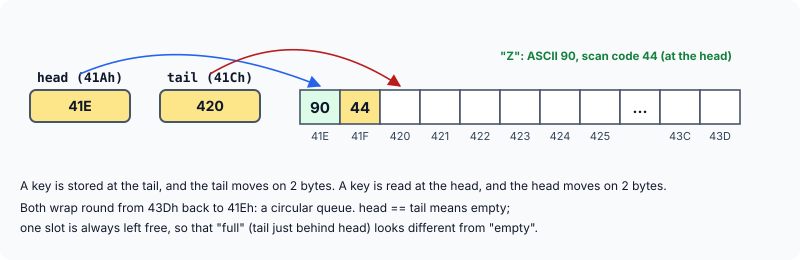
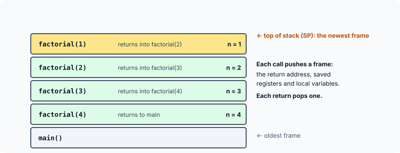

title : The Keyboard Queue and the Function-Call Stack

summary : Two data structures every program relies on without seeing them: the circular queue that holds the keys you type before a program reads them, and the stack that remembers where each function call must return to. Simulate both, and see how recursion builds and unwinds stack frames.

# The Keyboard Queue and the Function-Call Stack

The queue and the stack from the data structures chapter are not only textbook exercises. Two of them are working inside every computer all the time: a **queue** collects the keys you type until a program is ready to read them, and a **stack** remembers where every function call must return to. This article looks at both.

## The Keyboard Queue

Every key typed on a PC first goes to a place called the **keyboard buffer**, and waits there until a program reads it — so typing ahead while a program is busy does not lose keys. On a DOS PC, the keyboard buffer was 32 bytes of the BIOS data area, at addresses 41E to 43D. Each key takes **two bytes**: its ASCII code and its **scan code** (a number identifying the physical key). So the buffer holds up to 16 keys.

Keys are processed in the order they were typed, first come first served — so the keyboard buffer is a **queue**. Two pointers, each 2 bytes, keep track of it:

- the **head**, stored at 41A, holds the offset of the next key to be **read**;
- the **tail**, stored at 41C, holds the offset of the next **free** slot, where the next key typed will be stored.

The offsets are measured from address 400. When the buffer is empty, head and tail are equal — both 1E, the start of the buffer. Suppose we type **Z**: its ASCII code (90) and scan code (44) are stored at 41E and 41F, and the tail moves on by 2, to 20.



(Older books label these two locations the other way round, as tail at 41A and head at 41C. In the IBM BIOS data area, 41A holds the head — the next key to be read — and 41C the tail.)

As more keys are typed, they are stored after Z and the tail moves on each time. In the meantime, as a program reads the keys, the head moves on too, towards the tail. When the tail reaches the end of the buffer, it **wraps round** to the beginning (41E): the first slots can be reused because their keys have already been read. This is a **circular queue**, built from an array and two indexes instead of a linked list.

Here it is in our simulated memory. `key_pressed()` does what the keyboard interrupt routine did, and `read_key()` what `getch()` did:

```c runnable
#include <stdio.h>
#include <stdint.h>

static unsigned char memory[1 << 20];         /* simulated real-mode memory */

/* BIOS data area: offsets are relative to 400h */
#define HEAD    0x41A                          /* offset of the next key to be read */
#define TAIL    0x41C                          /* offset of the next free slot */
#define BUF_LO  0x1E                           /* buffer: 41Eh ... */
#define BUF_HI  0x3E                           /* ... up to 43Dh (32 bytes) */

unsigned get16(uint32_t a) { return memory[a] | (unsigned)memory[a + 1] << 8; }
void put16(uint32_t a, unsigned v) { memory[a] = (unsigned char)v; memory[a + 1] = (unsigned char)(v >> 8); }

/* what the keyboard hardware routine does when a key is pressed */
int key_pressed(unsigned char ascii, unsigned char scan)
{
    unsigned tail = get16(TAIL);
    unsigned next = tail + 2 == BUF_HI ? BUF_LO : tail + 2;   /* wrap round */

    if (next == get16(HEAD))
        return 0;                              /* full: the PC beeps, the key is lost */
    memory[0x400 + tail] = ascii;
    memory[0x400 + tail + 1] = scan;
    put16(TAIL, next);
    return 1;
}

/* what getch() does: take the key at the head, if there is one */
int read_key(unsigned char *ascii)
{
    unsigned head = get16(HEAD);

    if (head == get16(TAIL))
        return 0;                              /* head == tail: the queue is empty */
    *ascii = memory[0x400 + head];
    put16(HEAD, head + 2 == BUF_HI ? BUF_LO : head + 2);
    return 1;
}

void show(const char *what)
{
    printf("%-22s head = %03X  tail = %03X  [", what, 0x400 + get16(HEAD), 0x400 + get16(TAIL));
    for (unsigned off = BUF_LO; off < BUF_HI; off += 2) {
        unsigned char c = memory[0x400 + off];
        putchar(c ? c : '.');
    }
    printf("]\n");
}

int main(void)
{
    unsigned char ch;

    put16(HEAD, BUF_LO);                       /* empty: both point at 41Eh */
    put16(TAIL, BUF_LO);
    show("empty");

    key_pressed('Z', 0x2C);                    /* ASCII 90, scan code 44 */
    show("after Z");
    key_pressed('i', 0x17);
    key_pressed('p', 0x19);
    show("after i, p");

    read_key(&ch);
    printf("read '%c'\n", ch);
    show("after reading");

    int stored = 0;
    for (const char *s = "abcdefghijklmnopqrst"; *s != '\0'; s++)
        stored += key_pressed((unsigned char)*s, 0);
    printf("typed 20 more keys, %d fit\n", stored);
    show("full");

    printf("read: ");
    while (read_key(&ch))
        putchar(ch);
    printf("\n");
    show("after reading all");
    return 0;
}
```

```
empty                  head = 41E  tail = 41E  [................]
after Z                head = 41E  tail = 420  [Z...............]
after i, p             head = 41E  tail = 424  [Zip.............]
read 'Z'
after reading          head = 420  tail = 424  [Zip.............]
typed 20 more keys, 13 fit
full                   head = 420  tail = 41E  [Zipabcdefghijklm]
read: ipabcdefghijklm
after reading all      head = 41E  tail = 41E  [Zipabcdefghijklm]
```

Points to notice:

- **Empty** means `head == tail`. That is why the buffer can hold only **15** keys, not 16: if the 16th key were stored, the tail would wrap round to equal the head, and a full buffer would look exactly like an empty one. So one slot is always left free; when the buffer is full, the PC simply beeps and the key is lost. In the run above, after one key was read, 2 keys were waiting and 13 more fitted: 15 in all.
- **Wrapping** is the line `tail + 2 == BUF_HI ? BUF_LO : tail + 2`: moving past the last slot goes back to the first.
- Reading a key does not erase it: the bytes stay in the buffer (as the last line shows), but they are no longer **between** head and tail, so they no longer count. The same happens with deleted files on a disk.

On a DOS PC, a program could watch this happen by pointing `far` pointers at 41A, 41C and 41E and printing the head, the tail and the 32 bytes each time a key was hit. (The original program did exactly that.)

## Function Calls and the Stack

Every C program depends on a **stack**: it is how the computer implements function calls. Consider:

```c
main()                     /* main() begins at address 500 */
{
    display();             /* this call is at address 505 */
    show();                /* 510 */
    puts("a");             /* 515 */
}

display()                  /* begins at 1000 */
{
    puts("inside display");
}

show()                     /* begins at 2000 */
{
    puts("inside show");
}
```

While a program runs, the processor keeps the address of the next instruction to execute in a register — on the 8086, the pair **CS:IP** (code segment and instruction pointer). When execution of `main()` reaches the call to `display()`, CS:IP holds the address of the following instruction, 510. Control must now go to `display()` at 1000. But if it simply jumped there, how would it know where to come back to afterwards?

That is where the stack comes in. The computer first **pushes the return address** — 510 — onto the stack, and only then jumps to `display()`. When `display()` has finished, its last instruction (`RET`) **pops** the address from the stack into CS:IP, and execution continues at 510 — not at 515 or anywhere else. Exactly the same happens when `show()` is called: 515 is pushed, and popped again when `show()` returns.

This program models the process with an array as the stack:

```c runnable
#include <stdio.h>

/* A tiny model of how CALL and RET use the stack. The "program" is
   main() at 500, display() at 1000 and show() at 2000, as in the text. */

static int stack[16];
static int sp = 16;                            /* the stack grows downwards */
static int ip;                                 /* address of the next instruction */

void show_stack(void)
{
    printf("      stack:");
    if (sp == 16)
        printf(" (empty)");
    for (int i = sp; i < 16; i++)
        printf(" %d", stack[i]);
    printf("\n");
}

/* CALL: push the return address, then jump to the function */
void call(int target, int return_address, const char *name)
{
    stack[--sp] = return_address;
    printf("ip=%4d  call %s: push %d, jump to %d\n", ip, name, return_address, target);
    ip = target;
    show_stack();
}

/* RET: pop the return address into ip */
void ret(void)
{
    int addr = stack[sp++];
    printf("ip=%4d  ret: pop %d, jump back to %d\n", ip, addr, addr);
    ip = addr;
    show_stack();
}

int main(void)
{
    ip = 505;                                  /* main() reaches the call to display() */
    call(1000, 510, "display");
    printf("         ...display() runs: puts(\"inside display\")\n");
    ip = 1010;
    ret();

    call(2000, 515, "show");                   /* now at 510: the call to show() */
    printf("         ...show() runs: puts(\"inside show\")\n");
    ip = 2010;
    ret();

    printf("ip=%4d  main() goes on with puts(\"a\")\n", ip);
    return 0;
}
```

```
ip= 505  call display: push 510, jump to 1000
      stack: 510
         ...display() runs: puts("inside display")
ip=1010  ret: pop 510, jump back to 510
      stack: (empty)
ip= 510  call show: push 515, jump to 2000
      stack: 515
         ...show() runs: puts("inside show")
ip=2010  ret: pop 515, jump back to 515
      stack: (empty)
ip= 515  main() goes on with puts("a")
```

Why a stack, rather than a single "return address" variable? Because functions call other functions. If `display()` itself called a third function, a second return address would be pushed **on top** of the first, and the returns would pop them in reverse order — the last call made is the first to return. That is precisely last in, first out.

### Stack frames and recursion

In fact, each call pushes more than a return address. The compiler also pushes the function's arguments and saved registers (on the 8086, the old value of the **BP**, base pointer, register), and reserves room for its local variables. All of that together is the function's **stack frame**. The register **SP** (stack pointer) always points to the top of the stack; on the 8086, pushing a 2-byte value decremented SP by 2 — the stack grows **downwards** in memory.

Because every call gets its own frame, a recursive function can call itself and each call has its own copy of its parameters and local variables:

```c runnable
#include <stdio.h>

int depth = 0;

void indent(void)
{
    for (int i = 0; i < depth; i++)
        printf("    ");
}

int factorial(int n)
{
    indent();
    printf("factorial(%d) called\n", n);

    depth++;                                   /* one more frame on the stack */
    int result = (n <= 1) ? 1 : n * factorial(n - 1);
    depth--;                                   /* its frame is removed again */

    indent();
    printf("factorial(%d) returns %d\n", n, result);
    return result;
}

int main(void)
{
    factorial(4);
    return 0;
}
```

```
factorial(4) called
    factorial(3) called
        factorial(2) called
            factorial(1) called
            factorial(1) returns 1
        factorial(2) returns 2
    factorial(3) returns 6
factorial(4) returns 24
```

When `factorial(1)` is running, there are five frames on the stack — `main()`, and one for each call with *n* = 4, 3, 2 and 1 — each with its own `n`:



Each return pops the top frame and continues the call below it, where its `n` is still intact. Recursion that goes too deep — say a million levels, or infinite recursion by mistake — runs out of stack space: a **stack overflow**, which crashes the program.

:::callout
Older books then show a trick: a function that finds its own return address on the stack — with the DOS macros `MK_FP(_SS, _SP + 2)` and `MK_FP(_CS, *ptr)` — and **calls** it, so that the code after the call runs twice. It demonstrates that the return address really is on the stack, but it relies on exact details of one compiler's frame layout and is undefined behaviour in C. Modern compilers offer a non-standard way to *read* the return address (GCC's `__builtin_return_address(0)`), used by debuggers and profilers; calling it is still not safe. Overwriting a return address is also exactly what **buffer overflow attacks** do — one more reason never to write past the end of a local array.
:::

## Key Takeaways

- The keyboard buffer is a circular queue: keys are added at the tail and read from the head, and both wrap round. Head equal to tail means empty, so one slot is always left free.
- A circular queue in an array needs only two indexes and a wrap-round rule.
- A function call pushes the return address on the stack and jumps to the function; returning pops the address back. Nested calls return in reverse order — a stack.
- Each call gets a stack frame holding its return address, arguments, saved registers and local variables. That is what gives every recursive call its own variables.
- Too-deep recursion overflows the stack; writing past a local array can overwrite a return address.

## Practice Questions

:::details[The keyboard buffer's head is 2A and its tail is 30. How many keys are waiting?]
(30 − 2A) / 2 = 6 / 2 = **3** keys.
:::

:::details[The head is 38 and the tail is 22. How many keys are waiting? (The buffer runs from 1E to 3D.)]
The tail has wrapped round. From 38 to the end (3E) is 6 bytes, and from 1E to 22 is 4 bytes: 10 bytes, so **5** keys.
:::

:::details[If main() calls a(), a() calls b() and b() calls c(), in what order are the return addresses popped?]
The return address into `b()` first (when `c()` returns), then the one into `a()`, then the one into `main()` — the reverse of the order in which they were pushed.
:::

:::details[Why does a recursive function need a condition that stops the recursion?]
Every call pushes a new frame on the stack, and frames are only removed when calls return. Without a stopping condition (like `n <= 1` in `factorial()`), calls never return and frames pile up until the stack runs out of space — a stack overflow.
:::
