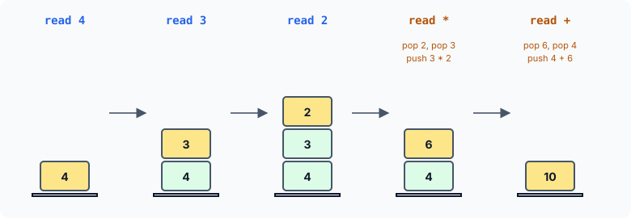

title : Infix to Postfix, and Evaluating Postfix Expressions

summary : How does a compiler get X = A / B + C * D - F * G / Q in the right order? Convert infix expressions to postfix with an operator stack, respecting priority and parentheses, then evaluate postfix with a number stack. Fixes the classic version's missing minus sign and empty-stack bug.

# Infix to Postfix, and Evaluating Postfix Expressions

When high-level programming languages first appeared, one of the big problems computer scientists faced was generating machine instructions that evaluate an arithmetic expression correctly. Converting an assignment such as

```
X = A / B + C * D - F * G / Q
```

into a correct sequence of instructions was a formidable task. That it is no longer considered formidable is a tribute to the elegant and simple solutions found. Today it is one of the easier parts of writing a compiler — and the solution is built on a **stack**.

## Infix and Postfix

To fix the order in which an expression is evaluated, every language gives each operator a **priority**: `*`, `/` and `%` before `+` and `-`, and operators of equal priority from left to right. Even so, how can a program read an expression and produce code that respects all of that?

The trick is to rewrite the expression in a form called **postfix** notation. The usual way of writing expressions, with each operator **between** its operands, is called **infix**. In postfix, each operator comes **after** its operands. For example:

| Infix | Postfix |
|---|---|
| `A * B / C` | `A B * C /` |
| `A + B * C` | `A B C * +` |
| `(A + B) * C` | `A B + C *` |

Read `A B * C /` from left to right: the multiplication comes immediately after its two operands, A and B. Imagine that A × B is computed and the result stored in T. Then the division comes immediately after **its** two operands, T and C.

Postfix has three valuable properties:

- the operands stay in the **same order** as in the infix expression;
- **no parentheses** are needed — the expression is unambiguous without them;
- when the postfix expression is evaluated, the **priority of the operators no longer matters**: each operator simply applies to the two values just before it.

(Postfix is also called *Reverse Polish Notation*, after the Polish logician Jan Łukasiewicz, who invented the prefix form.)

## Converting Infix to Postfix

The conversion reads the infix expression from left to right, copying **operands** straight to the output and holding **operators** on a stack until it is their turn:

```c runnable
#include <stdio.h>
#include <ctype.h>

#define MAX 100

/* a stack of operator characters */
char stack[MAX];
int top = -1;                                  /* -1 means the stack is empty */

void push(char item)
{
    if (top == MAX - 1) {
        printf("\nStack is full\n");
        return;
    }
    stack[++top] = item;
}

char pop(void)
{
    return stack[top--];                       /* callers check top first */
}

/* higher number = binds more tightly */
int priority(char op)
{
    if (op == '*' || op == '/' || op == '%')
        return 2;
    if (op == '+' || op == '-')
        return 1;
    return 0;                                  /* '(' */
}

int is_operator(char c)
{
    return c == '+' || c == '-' || c == '*' || c == '/' || c == '%';
}

/* converts the infix expression s to postfix in target (operands separated by spaces) */
void to_postfix(const char *s, char *target)
{
    char *t = target;

    top = -1;
    while (*s) {
        if (*s == ' ' || *s == '\t') {         /* skip white space */
            s++;
        } else if (isalnum((unsigned char)*s)) {   /* an operand: copy it whole */
            while (isalnum((unsigned char)*s))
                *t++ = *s++;
            *t++ = ' ';
        } else if (*s == '(') {
            push(*s++);
        } else if (*s == ')') {                /* output operators back to the '(' */
            while (top != -1 && stack[top] != '(') {
                *t++ = pop();
                *t++ = ' ';
            }
            if (top != -1)
                pop();                         /* discard the '(' */
            s++;
        } else if (is_operator(*s)) {
            /* first output the operators that must be applied before this one */
            while (top != -1 && stack[top] != '(' && priority(stack[top]) >= priority(*s)) {
                *t++ = pop();
                *t++ = ' ';
            }
            push(*s++);
        } else {
            s++;                               /* ignore anything else */
        }
    }
    while (top != -1) {                        /* output whatever is left */
        *t++ = pop();
        *t++ = ' ';
    }
    if (t > target)
        t--;                                   /* drop the last space */
    *t = '\0';
}

int main(void)
{
    const char *tests[] = {
        "A * B / C",
        "A / B + C * D - F * G / Q",
        "(A + B) * (C - D)",
        "A - B - C",
        "12 + 3 * (40 - 5) % 7"
    };
    char target[MAX];

    for (int i = 0; i < 5; i++) {
        to_postfix(tests[i], target);
        printf("%-28s ->  %s\n", tests[i], target);
    }
    return 0;
}
```

```
A * B / C                    ->  A B * C /
A / B + C * D - F * G / Q    ->  A B / C D * + F G * Q / -
(A + B) * (C - D)            ->  A B + C D - *
A - B - C                    ->  A B - C -
12 + 3 * (40 - 5) % 7        ->  12 3 40 5 - * 7 % +
```

### The rules

For each item read from the infix expression:

1. **An operand** (a run of letters or digits) is copied to the output at once.
2. **`(`** is pushed onto the stack. It marks where a parenthesised part began.
3. **`)`** pops operators from the stack to the output until the matching `(` is reached; the `(` itself is then discarded. Everything inside the parentheses has now been output.
4. **An operator** first pops to the output every operator on the stack that must be applied **before** it — those with **higher or equal** priority, stopping at a `(` — and then is pushed itself.
5. **At the end**, all remaining operators are popped to the output.

Rule 4 is the heart of it. Equal priority counts as "before" because operators of equal priority work **left to right**: in `A - B - C`, the first `-` must be applied first, giving `A B - C -`, which means (A − B) − C. If equal operators were left on the stack, the result would be `A B C - -`, meaning A − (B − C) — a different answer.

Here is rule 4 at work on `A / B + C * D`:

| Read | Action | Stack | Output |
|---|---|---|---|
| `A` | output it | | `A` |
| `/` | stack empty: push | `/` | `A` |
| `B` | output it | `/` | `A B` |
| `+` | `/` has higher priority: pop it; push `+` | `+` | `A B /` |
| `C` | output it | `+` | `A B / C` |
| `*` | `+` has lower priority: leave it; push `*` | `+ *` | `A B / C` |
| `D` | output it | `+ *` | `A B / C D` |
| end | pop everything | | `A B / C D * +` |

### Details of the code

- The stack holds operator characters in the array `stack`, with `top` the index of the top item, and −1 for an empty stack. The loops always check `top != -1` **before** looking at `stack[top]` — so `pop()` is never called on an empty stack.
- `isalnum((unsigned char)*s)` tests for a letter or digit; the cast is needed because the `<ctype.h>` functions must not be given a negative `char`. A whole run is copied, so the multi-digit number `12` stays one operand. A space is written after each item so that `12 3` cannot run together as `123`.
- `priority()` returns 2 for `*`, `/`, `%` and 1 for `+`, `-`. It returns 0 for `(`, but the loop never compares against `(` anyway: it stops there.

:::callout
A widely printed version of this program has two bugs. It leaves `-` out of the list of operators, so a minus sign is silently dropped from the output. And when the operator loop empties the stack, it calls `pop()` once more: the empty-stack value (−1) is returned as a **character**, printed as "Stack is empty", and then pushed back onto the stack, where it later appears in the output as a stray character. Checking for an empty stack before every pop, as here, avoids both.
:::

## Evaluating a Postfix Expression

The great virtue of postfix notation is that it is easy to **evaluate**: no parentheses, no priorities. Scan the expression from left to right with a stack of numbers:

- a **number** is pushed;
- an **operator** pops the top two numbers, applies itself to them, and pushes the result.

When the scan ends, the stack holds exactly one number: the value of the expression.



```c runnable
#include <stdio.h>
#include <stdlib.h>
#include <ctype.h>

#define MAX 25

int stack[MAX];
int top = -1;

int push(int item)
{
    if (top == MAX - 1)
        return 0;
    stack[++top] = item;
    return 1;
}

int pop(int *item)
{
    if (top == -1)
        return 0;
    *item = stack[top--];
    return 1;
}

/* evaluates a postfix expression of whole numbers separated by spaces;
   returns 1 and stores the result, or returns 0 if the expression is bad */
int evaluate(const char *s, int *result)
{
    top = -1;
    while (*s) {
        if (*s == ' ' || *s == '\t') {
            s++;
        } else if (isdigit((unsigned char)*s)) {   /* a number: push it */
            char *end;
            long n = strtol(s, &end, 10);
            if (!push((int)n))
                return 0;
            s = end;
        } else {                               /* an operator: pop two, push result */
            int n1, n2, n3;
            if (!pop(&n1) || !pop(&n2))        /* n1 is the RIGHT operand */
                return 0;
            switch (*s) {
            case '+': n3 = n2 + n1; break;
            case '-': n3 = n2 - n1; break;
            case '*': n3 = n2 * n1; break;
            case '/':
            case '%':
                if (n1 == 0) {
                    printf("Division by zero\n");
                    return 0;
                }
                n3 = (*s == '/') ? n2 / n1 : n2 % n1;
                break;
            default:
                printf("Unknown operator %c\n", *s);
                return 0;
            }
            push(n3);
            s++;
        }
    }
    if (!pop(result) || top != -1)            /* exactly one value must remain */
        return 0;
    return 1;
}

int main(void)
{
    const char *tests[] = {"4 3 2 * +", "12 3 35 * 7 % +", "8 2 - 3 /", "5 +", "9 0 /"};
    int r;

    for (int i = 0; i < 5; i++) {
        if (evaluate(tests[i], &r))
            printf("%-16s = %d\n", tests[i], r);
        else
            printf("%-16s : not a valid expression\n", tests[i]);
    }
    return 0;
}
```

```
4 3 2 * +        = 10
12 3 35 * 7 % +  = 12
8 2 - 3 /        = 2
5 +              : not a valid expression
Division by zero
9 0 /            : not a valid expression
```

### Details of the code

- **Order of operands.** The first value popped, `n1`, is the **right** operand, and the second, `n2`, the left one — because the left operand was pushed first. So `8 2 -` computes `n2 - n1` = 8 − 2 = 6, and the expression `8 2 - 3 /` then gives 6 / 3 = 2. Getting this backwards gives wrong answers for `-`, `/` and `%`.
- **Multi-digit numbers.** `strtol()` reads a whole number and sets `end` to the first character after it, so `12` and `35` are read correctly. (Older versions handle only single digits, with `nn = *s - '0'`; converting a digit character to its value that way is correct, but limits every number to 0–9.)
- **Errors.** `pop()` and `push()` report failure instead of returning a made-up value, and `evaluate()` checks them: `5 +` has too few operands, and a valid expression must leave exactly one value on the stack. Division by zero is caught before it happens — in C, it would be undefined behaviour.

### Putting the two together

A program that reads an infix expression, converts it with `to_postfix()` and evaluates the result with `evaluate()` is a working calculator. For example, `12 + 3 * (40 - 5) % 7` converts to `12 3 40 5 - * 7 % +`, and evaluating that gives 3 × 35 = 105, 105 % 7 = 0, and 12 + 0 = **12** — the same as C itself computes for that expression. Compilers work the same way, except that instead of computing values they emit an instruction for each operator.

## Key Takeaways

- In postfix notation each operator follows its operands; no parentheses are needed and priorities no longer matter when evaluating.
- Infix to postfix: output operands directly; push `(`; on `)` pop to the matching `(`; before pushing an operator, pop every stacked operator of higher **or equal** priority (equal, because operators group left to right); pop the rest at the end.
- Postfix evaluation: push numbers; for an operator, pop the right operand, then the left, compute, and push the result; one value must remain.
- Always check for an empty stack before popping, and for division by zero.

## Practice Questions

:::details[Convert A + B * C - D / E to postfix.]
`A B C * + D E / -`. B × C is computed first and added to A; D / E is computed and then subtracted.
:::

:::details[Convert (A - B) * (C + D) / E to postfix.]
`A B - C D + * E /`
:::

:::details[Evaluate the postfix expression 6 2 / 3 - 4 2 * +.]
6 / 2 = 3; 3 − 3 = 0; 4 × 2 = 8; 0 + 8 = **8**.
:::

:::details[Why must the converter pop operators of EQUAL priority before pushing a new one?]
Because operators of equal priority are applied left to right. For `A - B + C`, popping the `-` before pushing `+` gives `A B - C +`, that is (A − B) + C, which is correct. Leaving `-` on the stack would give `A B C + -`, that is A − (B + C).
:::
