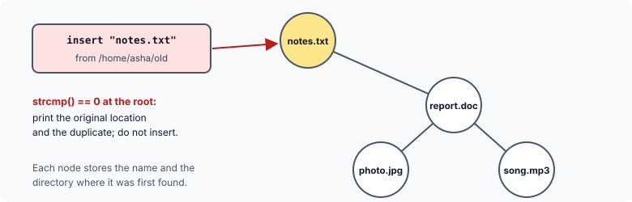

title : Locating Duplicate File Names with a Binary Search Tree

summary : Over time a disk collects files with the same name in different folders. Walk every directory, insert each file name into a binary search tree, and report a duplicate the moment a name is found already in the tree. Includes a runnable version and a real directory walk with nftw().

# Locating Duplicate File Names with a Binary Search Tree

When a disk is new, its files and directories are well organised. As it grows older, some laxity sets in, and files with the same name pile up in different directories: three copies of `notes.txt`, two `report.doc`s. A program can find them.

The idea combines two things from this course: a **binary search tree** and a walk through **every directory** on the disk. Each file found is inserted into the tree by name. If the name is already there, the file is a duplicate, and both locations are reported.

Why a tree? Because each new name must be compared with every name seen so far. With a list, that means comparing against all of them. With a binary search tree, each comparison throws away half the remaining tree (when the tree is reasonably balanced), so even thousands of names need only a dozen or so comparisons each — and the check happens **while** the tree is being built.

## The Tree

Each node holds the file name, and the directory where that name was **first** found:

```c
struct btreenode
{
    struct btreenode *leftchild;
    char *name;                 /* the file name */
    char *loc;                  /* the directory it was first found in */
    struct btreenode *rightchild;
};
```



## The Program

The runnable version below feeds `insert()` a list of the (directory, name) pairs that a walk through a disk might produce:

```c runnable
#include <stdio.h>
#include <stdlib.h>
#include <string.h>

struct btreenode
{
    struct btreenode *leftchild;
    char *name;                                /* the file name */
    char *loc;                                 /* the directory it was first found in */
    struct btreenode *rightchild;
};

/* a copy of s in memory of its own */
char *copy_string(const char *s)
{
    char *p = malloc(strlen(s) + 1);
    if (p == NULL) {
        printf("out of memory\n");
        exit(EXIT_FAILURE);
    }
    return strcpy(p, s);
}

/* inserts the file f found in directory loc; reports it if the name is already in the tree */
void insert(struct btreenode **sr, const char *loc, const char *f)
{
    while (*sr != NULL) {
        int cmp = strcmp(f, (*sr)->name);
        if (cmp == 0) {                        /* a duplicate name */
            printf("org : %s/%s\n", (*sr)->loc, (*sr)->name);
            printf("dup : %s/%s\n\n", loc, f);
            return;
        }
        sr = (cmp < 0) ? &(*sr)->leftchild : &(*sr)->rightchild;
    }

    *sr = malloc(sizeof **sr);
    if (*sr == NULL) {
        printf("out of memory\n");
        exit(EXIT_FAILURE);
    }
    (*sr)->leftchild = (*sr)->rightchild = NULL;
    (*sr)->name = copy_string(f);
    (*sr)->loc = copy_string(loc);
}

void free_tree(struct btreenode *sr)
{
    if (sr == NULL)
        return;
    free_tree(sr->leftchild);
    free_tree(sr->rightchild);
    free(sr->name);
    free(sr->loc);
    free(sr);
}

int main(void)
{
    /* the files a walk through the disk might find, as (directory, name) */
    const char *found[][2] = {
        {"/home/asha", "notes.txt"},
        {"/home/asha", "report.doc"},
        {"/home/asha/old", "notes.txt"},
        {"/home/asha/old", "photo.jpg"},
        {"/home/asha/backup", "report.doc"},
        {"/home/asha/backup", "notes.txt"},
        {"/home/asha/music", "song.mp3"}
    };
    struct btreenode *bt = NULL;

    for (size_t i = 0; i < sizeof found / sizeof found[0]; i++)
        insert(&bt, found[i][0], found[i][1]);

    free_tree(bt);
    return 0;
}
```

```
org : /home/asha/notes.txt
dup : /home/asha/old/notes.txt

org : /home/asha/report.doc
dup : /home/asha/backup/report.doc

org : /home/asha/notes.txt
dup : /home/asha/backup/notes.txt

```

### insert()

`insert()` walks down the tree comparing the new name `f` with each node's name using `strcmp()`:

- **Zero** means the name is already in the tree: the file is a duplicate. The original location stored in the node and the new location are printed, and the new file is **not** inserted. (A third `notes.txt` is reported against the **first** one, since that is the location the node remembers.)
- **Negative** means the name comes earlier alphabetically: go to the left subtree. **Positive**: go right.

When the walk reaches an empty link, the name is new: a node is allocated there. The walk uses the same pointer-to-a-link technique as the BST articles — `sr` points to the link that will receive the new node — so the empty tree needs no special case.

### Why the strings are copied

The node does not simply point at the strings it was given; it stores **copies** of them in memory of its own (`copy_string()`). In the real program, the directory and file names come from buffers that are **reused** for every file the directory walk finds. A node that just stored the pointer would find its name overwritten moments later. `malloc(strlen(s) + 1)` allocates exactly enough for the characters and the `'\0'`.

Older versions store the file name in a fixed array, `char data[13]` — DOS names were at most 8 characters, a dot and 3 more — and only the location as a pointer. Modern file names can be up to 255 characters, so both are allocated to fit. And since every node and both its strings were allocated with `malloc()`, `free_tree()` frees all three for every node — the original program never freed anything.

## Walking a Real Disk

The original program walked the disk with the DOS functions `findfirst()` and `findnext()`. Its heart was a recursive function, `disktree()`:

1. remember the current directory (`getcwd()`);
2. look at every entry in it (`findfirst("*.*", ...)`, then `findnext()` until there are none left), skipping the entries `.` and `..` (the directory itself and its parent);
3. if an entry is a **directory**, change into it (`chdir()`), call `disktree()` recursively, and change back (`chdir()` to the remembered directory);
4. otherwise insert the file name into the tree, along with the current directory.

`main()` saved the starting directory, changed to the root (`\`), called `disktree()`, and finally returned to where it started, so the user was not left in a different directory.

On Linux and other POSIX systems, the library function **`nftw()`** ("file tree walk") does the whole recursive walk for you. It calls a function you supply — a **callback**, as in the function pointers article — once for every file and directory under a starting point:

```c
#define _XOPEN_SOURCE 700                      /* for nftw() */
#include <ftw.h>
#include <stdio.h>
#include <stdlib.h>
#include <string.h>

struct btreenode
{
    struct btreenode *leftchild;
    char *name;
    char *loc;
    struct btreenode *rightchild;
};

static struct btreenode *bt = NULL;            /* nftw's callback cannot take extra arguments */

char *copy_string(const char *s, size_t n)
{
    char *p = malloc(n + 1);
    if (p == NULL)
        exit(EXIT_FAILURE);
    memcpy(p, s, n);
    p[n] = '\0';
    return p;
}

void insert(struct btreenode **sr, const char *loc, size_t loclen, const char *f)
{
    while (*sr != NULL) {
        int cmp = strcmp(f, (*sr)->name);
        if (cmp == 0) {
            printf("org : %s/%s\n", (*sr)->loc, (*sr)->name);
            printf("dup : %.*s/%s\n\n", (int)loclen, loc, f);
            return;
        }
        sr = (cmp < 0) ? &(*sr)->leftchild : &(*sr)->rightchild;
    }
    *sr = malloc(sizeof **sr);
    if (*sr == NULL)
        exit(EXIT_FAILURE);
    (*sr)->leftchild = (*sr)->rightchild = NULL;
    (*sr)->name = copy_string(f, strlen(f));
    (*sr)->loc = copy_string(loc, loclen);
}

/* called by nftw() for every file and directory under the starting point */
int visit(const char *path, const struct stat *sb, int type, struct FTW *ftw)
{
    (void)sb;
    if (type == FTW_F)                         /* an ordinary file */
        insert(&bt, path, (size_t)ftw->base - 1, path + ftw->base);
    return 0;                                  /* 0 = keep walking */
}

void free_tree(struct btreenode *sr)
{
    if (sr == NULL)
        return;
    free_tree(sr->leftchild);
    free_tree(sr->rightchild);
    free(sr->name);
    free(sr->loc);
    free(sr);
}

int main(int argc, char *argv[])
{
    const char *start = (argc > 1) ? argv[1] : ".";

    if (nftw(start, visit, 20, FTW_PHYS) != 0) {   /* walk every subdirectory */
        perror(start);
        return 1;
    }
    free_tree(bt);
    return 0;
}
```

Run on a small test directory, it prints (the order depends on the order in which the directories are read):

```
org : t/x.txt
dup : t/a/x.txt

org : t/c/y.c
dup : t/a/b/y.c

```

How it fits together:

- `nftw(start, visit, 20, FTW_PHYS)` walks everything under `start`. `visit` is passed as a **pointer to a function**. 20 is the maximum number of directories `nftw()` may keep open at once, and `FTW_PHYS` tells it not to follow symbolic links (otherwise a link pointing back up the tree could make it walk forever).
- For every entry, `nftw()` calls `visit()` with the full path, information about the file, its type (`FTW_F` for an ordinary file, `FTW_D` for a directory) and a `struct FTW`, whose `base` member is the position in the path where the file's own name begins. So `path + ftw->base` is the bare name, and the first `ftw->base - 1` characters are the directory.
- The tree is a global variable, because `nftw()` passes the callback only its own fixed arguments.
- `#define _XOPEN_SOURCE 700`, before any `#include`, asks the system headers to declare POSIX functions such as `nftw()`.

## Key Takeaways

- Inserting every file name into a binary search tree finds duplicates as the tree is built: `strcmp()` returning 0 means the name is already there.
- Store copies of strings that come from reused buffers; allocate `strlen(s) + 1` bytes for each.
- Walking a directory tree is naturally recursive: process the files, and recurse into each subdirectory, skipping `.` and `..`.
- On POSIX systems, `nftw()` does the walk and calls your function, through a function pointer, for every entry.
- Free every node and every string the tree allocated.

## Practice Questions

:::details[If the names are inserted in alphabetical order (a.txt, b.txt, c.txt, ...), what shape does the tree take, and how does that affect the program?]
Each new name is greater than all the others, so it always goes to the right: the tree becomes a straight line, like a linked list. Each insertion then compares against every name seen so far, and the program slows down. Directory listings are often in no particular order, which helps; a self-balancing tree, or a hash table, avoids the problem entirely.
:::

:::details[Why would storing the pointer f directly in the node (node->name = f) be a bug in the nftw() version?]
`f` points into the `path` buffer that `nftw()` reuses for the next entry. After the callback returns, the characters it points to are overwritten (or the memory is freed), so every node would end up with a wrong or invalid name.
:::

:::details[How would you change insert() so that a duplicate is reported against ALL the earlier locations, not just the first?]
Keep a linked list of locations in each node instead of a single `loc`: on a duplicate, print every location in the list, then add the new one to it.
:::

:::details[Why must the directory walk skip the entries . and ..?]
`.` is the directory itself and `..` its parent. Recursing into `.` would visit the same directory again and again forever, and `..` would climb back up the tree and visit everything again.
:::
