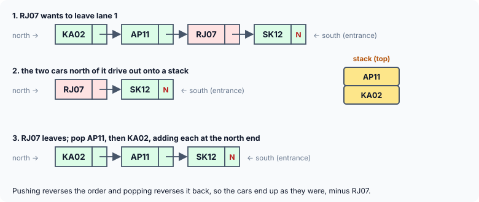

title : Simulating a Parking Garage with Queues and a Stack

summary : A complete application to finish the course: a parking garage whose lanes are linked-list queues, where a car leaving from the middle of a lane needs the cars in front of it moved out onto a stack and back. Combines queues, a stack, searching and careful pointer updates.

# Simulating a Parking Garage with Queues and a Stack

This last application brings several data structures together in one program.

**The problem.** A parking garage has 10 parking lanes, each able to hold 10 cars. As each car arrives or departs, the attendant enters `A` (arrival) or `D` (departure) and the car's registration number. Cars enter each lane at its **south** end and leave from its **north** end.

- When a car **arrives**, the program tells the attendant which lane and slot to park it in.
- When a car **departs**, its record is updated. If the car is not the northernmost in its lane, all the cars to its north are moved out, the car is driven out, and the other cars are put back **in the same order** they were in.
- Whenever a car leaves, the cars to its south move forward, so all the empty spaces are always at the south end of each lane.

## Choosing the Data Structures

- **Each lane is a queue.** Cars join at one end (the south end, the rear) and leave from the other (the north end, the front) — first in, first out. A linked list with `front` and `rear` pointers implements it, as in the queues article.
- **The cars moved out of the way form a stack.** The first car to drive out is the northernmost; when the cars come back, the last one out must go back in first, at the north end, so that the original order is restored. Last in, first out.
- Because a lane is a **linked list**, "the cars to the south move forward" happens by itself: removing a node closes the gap, and the cars behind it are now one place further forward.



## The Program

The original version reads the attendant's commands from the keyboard. Here the commands are listed in an array, so the program runs on its own. It uses 5 lanes to keep the output short; change `LANES` to 10 for the full garage.

```c runnable
#include <stdio.h>
#include <stdlib.h>
#include <string.h>

#define LANES 5
#define CAPACITY 10

struct node
{
    char plate[15];
    struct node *link;
};

/* each lane is a queue: front = north end (the exit), rear = south end (the entrance) */
struct node *front[LANES], *rear[LANES];

struct node *new_node(const char *plate)
{
    struct node *q = malloc(sizeof *q);
    if (q == NULL)
        exit(EXIT_FAILURE);
    snprintf(q->plate, sizeof q->plate, "%s", plate);
    q->link = NULL;
    return q;
}

/* a car enters at the south end of the lane */
void add_at_rear(int lane, const char *plate)
{
    struct node *q = new_node(plate);

    if (front[lane] == NULL)
        front[lane] = q;
    else
        rear[lane]->link = q;
    rear[lane] = q;
}

/* a car is put back at the north end of the lane */
void add_at_front(int lane, const char *plate)
{
    struct node *q = new_node(plate);

    q->link = front[lane];
    front[lane] = q;
    if (rear[lane] == NULL)
        rear[lane] = q;
}

/* the northernmost car drives out; its plate is copied into plate */
void remove_front(int lane, char *plate)
{
    struct node *q = front[lane];

    strcpy(plate, q->plate);
    front[lane] = q->link;
    if (front[lane] == NULL)                   /* the lane is now empty */
        rear[lane] = NULL;
    free(q);
}

/* a stack of plates, for cars that must move out of the way */
void push(struct node **top, const char *plate)
{
    struct node *q = new_node(plate);
    q->link = *top;
    *top = q;
}

void pop(struct node **top, char *plate)
{
    struct node *q = *top;
    strcpy(plate, q->plate);
    *top = q->link;
    free(q);
}

int count(const struct node *q)
{
    int c = 0;
    for (; q != NULL; q = q->link)
        c++;
    return c;
}

/* position of the car in the lane, counting from the north end (0), or -1 */
int search(const struct node *q, const char *plate)
{
    for (int s = 0; q != NULL; q = q->link, s++)
        if (strcmp(q->plate, plate) == 0)
            return s;
    return -1;
}

void arrive(const char *plate)
{
    int lane = -1, min = CAPACITY;

    for (int i = 0; i < LANES; i++) {          /* the lane with the most room */
        int s = count(front[i]);
        if (s < min) {
            min = s;
            lane = i;
        }
    }
    if (lane == -1) {
        printf("%s: no room available\n", plate);
        return;
    }
    add_at_rear(lane, plate);
    printf("%s: park in lane %d, slot %d\n", plate, lane, min);
}

void depart(const char *plate)
{
    int lane, s = -1;

    for (lane = 0; lane < LANES; lane++)
        if ((s = search(front[lane], plate)) != -1)
            break;
    if (lane == LANES) {
        printf("%s: no such car!\n", plate);
        return;
    }

    struct node *top = NULL;                   /* empty stack */
    char p[15];

    for (int i = 0; i < s; i++) {              /* move the cars to its north out */
        remove_front(lane, p);
        push(&top, p);
    }
    remove_front(lane, p);                     /* the car leaves */
    printf("%s: leaves lane %d (%d car%s moved out and back)\n", p, lane, s, s == 1 ? "" : "s");

    while (top != NULL) {                      /* the others return, in the same order */
        pop(&top, p);
        add_at_front(lane, p);
    }
}

void show(void)
{
    for (int i = 0; i < LANES; i++) {
        printf("  lane %d (north) ", i);
        for (const struct node *q = front[i]; q != NULL; q = q->link)
            printf("%s ", q->plate);
        printf("(south)\n");
    }
}

int main(void)
{
    /* the events, as the attendant would type them: A = arrival, D = departure */
    const char *events[][2] = {
        {"A", "MH01"}, {"A", "KA02"}, {"A", "DL03"}, {"A", "TN04"}, {"A", "GJ05"},
        {"A", "UP06"}, {"A", "RJ07"}, {"A", "WB08"}, {"D", "RJ07"}, {"D", "XX99"},
        {"A", "PB09"}
    };

    for (size_t i = 0; i < sizeof events / sizeof events[0]; i++) {
        if (events[i][0][0] == 'A')
            arrive(events[i][1]);
        else
            depart(events[i][1]);
    }
    show();

    for (int i = 0; i < LANES; i++) {          /* close the garage: free every node */
        char p[15];
        while (front[i] != NULL)
            remove_front(i, p);
    }
    return 0;
}
```

```
MH01: park in lane 0, slot 0
KA02: park in lane 1, slot 0
DL03: park in lane 2, slot 0
TN04: park in lane 3, slot 0
GJ05: park in lane 4, slot 0
UP06: park in lane 0, slot 1
RJ07: park in lane 1, slot 1
WB08: park in lane 2, slot 1
RJ07: leaves lane 1 (1 car moved out and back)
XX99: no such car!
PB09: park in lane 1, slot 1
  lane 0 (north) MH01 UP06 (south)
  lane 1 (north) KA02 PB09 (south)
  lane 2 (north) DL03 WB08 (south)
  lane 3 (north) TN04 (south)
  lane 4 (north) GJ05 (south)
```

## How It Works

### The lanes

`front[LANES]` and `rear[LANES]` are two arrays of pointers: lane *i* is the queue that runs from `front[i]` (its northernmost car) to `rear[i]` (its southernmost). As global arrays they start out all `NULL`: an empty garage.

Four small functions change a lane, and each keeps `front` and `rear` consistent — the lesson of the queues article:

- **`add_at_rear()`** — a car enters at the south end. In an empty lane it also becomes the front.
- **`remove_front()`** — the northernmost car drives out. If that empties the lane, `rear[lane]` is set to `NULL` too, so that it never points to a freed node.
- **`add_at_front()`** — a car is put back at the north end. In an empty lane it also becomes the rear.

(Older versions of this program use one "deque" function with a flag for top or bottom, and delete the *n*-th car without ever updating `rear` when the lane becomes empty, so the next arrival is linked to a node that has already been freed.)

### Arrivals

`arrive()` counts the cars in each lane and picks the lane with the fewest — the one with the most free space. `min` starts at `CAPACITY`, so a lane is chosen only if it has fewer than 10 cars; if every lane is full, `lane` stays −1 and "no room available" is reported. Otherwise the car is added at the rear, and its slot (the number of cars already in front of it) is reported.

### Departures

`depart()` first finds the car: `search()` walks each lane, counting from the north end, and returns the car's position `s`, or −1 if it is not in that lane. If no lane has it, "no such car!" is reported.

Then the three steps of the problem statement:

1. **Move the cars to its north out of the way**: the `s` cars at the front of the lane are removed one at a time and pushed onto the stack `top`.
2. **The car leaves**: it is now at the front, so `remove_front()` takes it out.
3. **Put the other cars back**: they are popped off the stack and added at the **front** of the lane, one at a time. The last car pushed (the one that was just north of the departed car) is popped first and goes in first; each later one goes in front of it. So the cars return in exactly their original order.

The stack is an ordinary linked-list stack: `push()` adds a node at the top and `pop()` removes it, copying the plate out first and then freeing the node.

### Freeing everything

At the end, `main()` empties every lane with `remove_front()`, freeing every node. The stack is always empty when `depart()` returns, so it never holds any memory afterwards.

## Key Takeaways

- Model each part of a problem with the structure that matches its behaviour: lanes are queues (first in, first out), and cars moved temporarily out of the way are a stack (last in, first out).
- Linked lists make "close the gap" automatic: removing a node moves everything behind it forward.
- Every function that changes a queue must keep `front` and `rear` consistent, including when the queue becomes empty or stops being empty.
- Pushing items onto a stack and popping them back reverses their order twice, so they return to the order they started in.

## Practice Questions

:::details[Lane 2 holds, from north to south, A B C D E. Car D leaves. What happens, and what does the lane hold afterwards?]
`search()` finds D at position 3. A, B and C are removed and pushed (the stack top is C). D is removed. C is popped and added at the front, then B, then A. The lane holds **A B C E**.
:::

:::details[Why are the returning cars added at the FRONT of the lane, not at the rear?]
They came from the north part of the lane, in front of every car still parked. Adding them at the rear would put them behind the cars that were south of the departed car, changing the order.
:::

:::details[What would go wrong if remove_front() did not set rear[lane] to NULL when the lane became empty?]
`rear[lane]` would still point to the node just freed. The next `add_at_rear()` on that lane would see `front[lane] == NULL` and set the new car as the front — but `rear` would be left pointing at freed memory until then, and any code that used `rear` while the lane was empty (for instance, displaying the last car) would read freed memory.
:::

:::details[How would you report the slot each car is in when the attendant asks for a list of the garage?]
Walk each lane from `front[i]` with a counter, printing the counter and the plate for each node — the same traversal as `search()`, without the comparison.
:::
